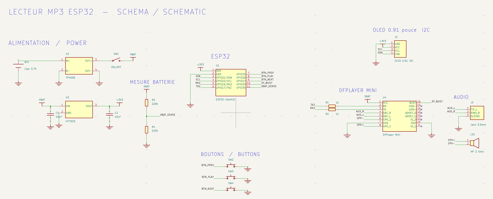
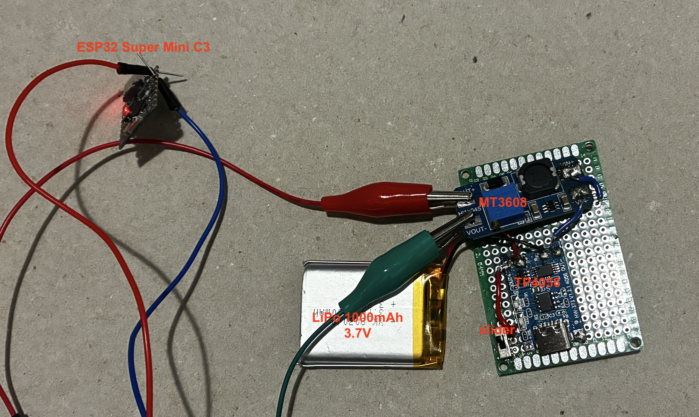
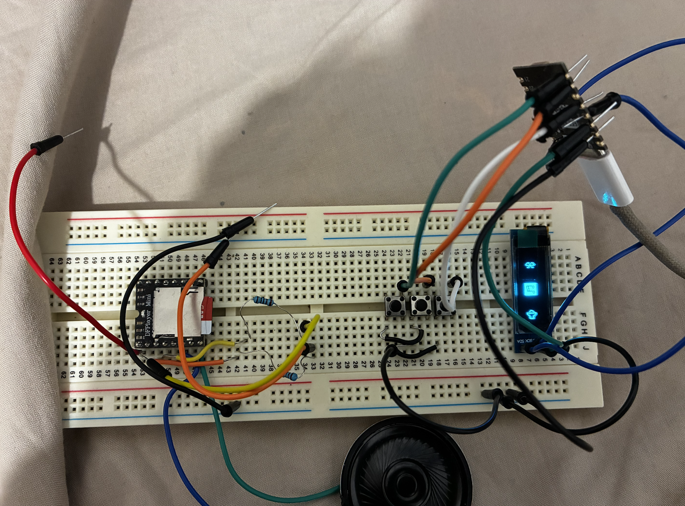

## Lecteur MP3 avec ESP32 C3 Super Mini / MP3 player with ESP32 C3 Super Mini

english below

Petit lecteur mp3 avec port jack + Bluetooth

# Architecture du repo

```
.
├── 00_photos/          images du montage, du banc de test et du produit final
├── 01_code/
│   └── player/
│       ├── player.ino  fichier principal : setup, loop, gestion des boutons
│       ├── menu.ino    affichage OLED et navigation dans le menu
│       └── audio.ino   pilotage du DFPlayer (lecture, pause, volume, piste)
└── README.md
```

# Matériel

| Catégorie | Composant |
|---|---|
| Affichage | ESP32 C3 Super Mini |
| Affichage | Écran OLED 0.91″ |
| Alimentation | Batterie LiPo 3.7 V |
| Alimentation | TP4056 |
| Alimentation | MT3608 |
| Son | DFPlayer + haut-parleur 2 Ω |
| Son | Carte SD |
| Autres | Connecteur Jack |
| Autres | PCB |
| Autres | Interrupteur à bascule |
| Autres | Bouton |

# Software

### Librairies
DFRobotDFPlayerMini
Wire
U8g2lib

- Etape 1 : Faire marcher DFPlayer + haut-parleur
- Etape 2 : Faire marcher DFPlayer + haut-parleur + boutons
- Etape 3 : Faire marcher OLED

Sites pratiques : lopaka, pour le design de l'interface et la génération plus rapide de code avec u8g2

- Etape 4 : Faire marcher OLED + boutons
- Etape 5 : Faire marcher DFPlayer + OLED + haut-parleur + boutons

Le code est disponible dans 01_code




### Alimentation



### Alimentation
- Chaîne : Lipo 3.7V, TP4056, interrupteur, MT3608 réglé à 5V
- Le 5V alimente le DFPlayer et la broche 5V de la carte
- Le 3V3 de la carte est une sortie du LDO embarqué, il alimente l'OLED. Ne rien injecter dessus
- Régler la sortie du MT3608 à 5.0V au multimètre, à vide, avant de brancher le reste. Trimpot 25 tours, il faut souvent 15 à 20 tours antihoraire avant que la tension bouge
- L'interrupteur est sur l'entrée du boost. Un boost laisse passer Vin vers Vout par la self et la diode, couper la sortie ne couperait rien
- Ne jamais alimenter la broche 5V pendant que l'USB-C est branché, la Super Mini n'a pas de OR-ing. Interrupteur sur OFF pour programmer

GPIO2, GPIO8 et GPIO9 sont évités : strapping, LED embarquée, bouton BOOT.

### Câblage
- DFPlayer alimenté en 5V, sa logique UART reste en 3.3V, compatible direct
- R1 et R2 : 1k en série sur l'UART, pour limiter le bruit côté DFPlayer
- Pull-ups I2C intégrées au module OLED, non représentées
- Boutons en INPUT_PULLUP, appui = niveau bas
- Jack = sortie DAC ligne, HP = sortie ampli interne. Les deux sortent en même temps


Le TP4056 gère la charge de la LiPo en USB. L’interrupteur à bascule coupe la sortie batterie vers l’ESP32 et le DFPlayer. Sur cette image, je m’assure que mon alimentation fonctionne. Il faudrait faire attention sur ce genre de module : il ne reconnaît que du USB-A vers USB-C pour la charge de la batterie.

### Banc de test



Montage sur breadboard pour valider avant le passage sur PCB/Breadboard universel.

# Produit final


---

## MP3 player with ESP32

Small mp3 player with jack output + Bluetooth

# Repo structure

```
.
├── 00_photos/          pictures of the build, test bench and final product
├── 01_code/
│   └── player/
│       ├── player.ino  main file: setup, loop, button handling
│       ├── menu.ino    OLED display and menu navigation
│       └── audio.ino   DFPlayer control (play, pause, volume, track)
└── README.md
```

# Hardware

| Category | Component |
|---|---|
| Display | ESP32 C3 Super Mini |
| Display | OLED screen 0.91″ |
| Power supply | LiPo battery 3.7 V |
| Power supply | TP4056 |
| Power supply | MT3608 |
| Audio | DFPlayer + 2 Ω speaker |
| Audio | SD card |
| Others | Jack connector |
| Others | PCB |
| Others | Toggle switch |
| Others | Button |

# Software

### Libraries
DFRobotDFPlayerMini
Wire
U8g2lib

- Step 1 : Get DFPlayer + speaker working
- Step 2 : Get DFPlayer + speaker + buttons working
- Step 3 : Get OLED working

Useful sites : lopaka, for interface design and faster u8g2 code generation

- Step 4 : Get OLED + buttons working
- Step 5 : Get DFPlayer + OLED + speaker + buttons working

The code is available in 01_code


### Power supply


- Chain : 3.7V Lipo, TP4056, switch, MT3608 set to 5V
- The 5V rail feeds the DFPlayer and the board 5V pin
- The board 3V3 pin is an output of the onboard LDO, it feeds the OLED. Do not drive anything into it
- Set the MT3608 output to 5.0V with a multimeter, unloaded, before wiring anything else. 25 turn trimpot, it often takes 15 to 20 counter clockwise turns before the voltage moves
- The switch sits on the boost input. A boost passes Vin to Vout through the inductor and diode, cutting the output would cut nothing
- Never power the 5V pin while USB-C is plugged in, the Super Mini has no OR-ing. Switch off to flash the board

  
GPIO2, GPIO8 and GPIO9 are avoided : strapping, onboard LED, BOOT button.

### Wiring
- DFPlayer runs on 5V, its UART logic stays at 3.3V, directly compatible
- R1 and R2 : 1k in series on the UART, to keep noise down on the DFPlayer side
- I2C pull-ups are on the OLED module, not drawn
- Buttons use INPUT_PULLUP, pressed = low
- Jack = DAC line output, speaker = internal amp output. Both play at the same time

The TP4056 handles charging the LiPo over USB. The toggle switch cuts the battery output to the ESP32 and the DFPlayer. In this image, I’m checking that my power supply works. You should be careful with this kind of module: it only recognizes USB-A to USB-C, for charging.


### Test bench


Breadboard setup used to validate each block before moving to the PCB.

# Final product


